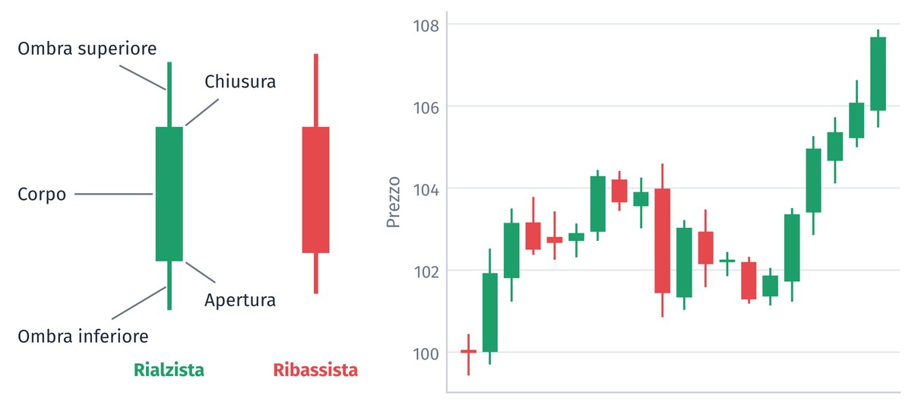
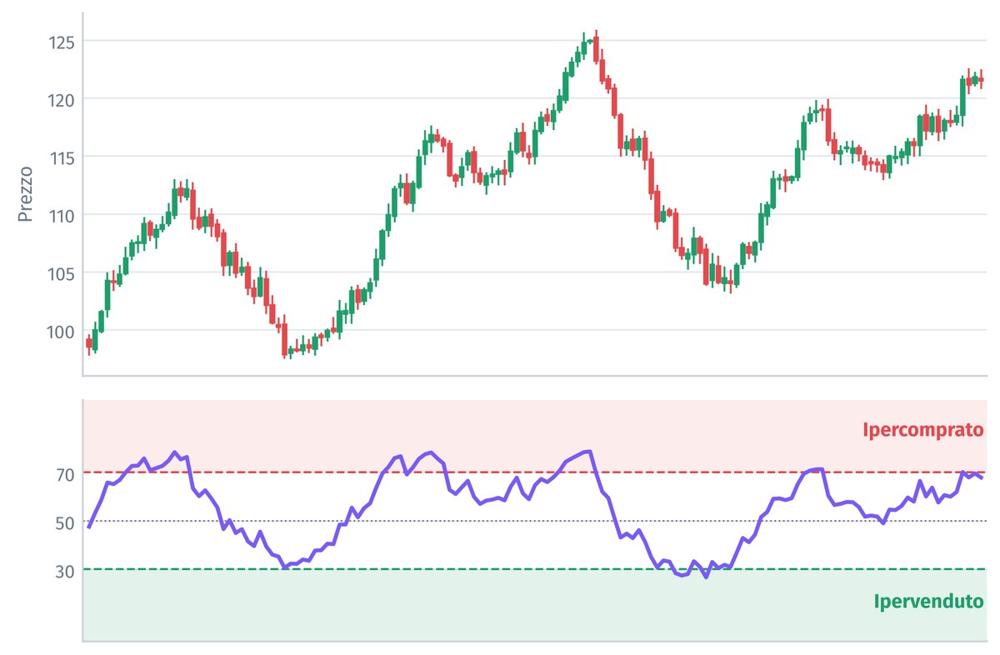
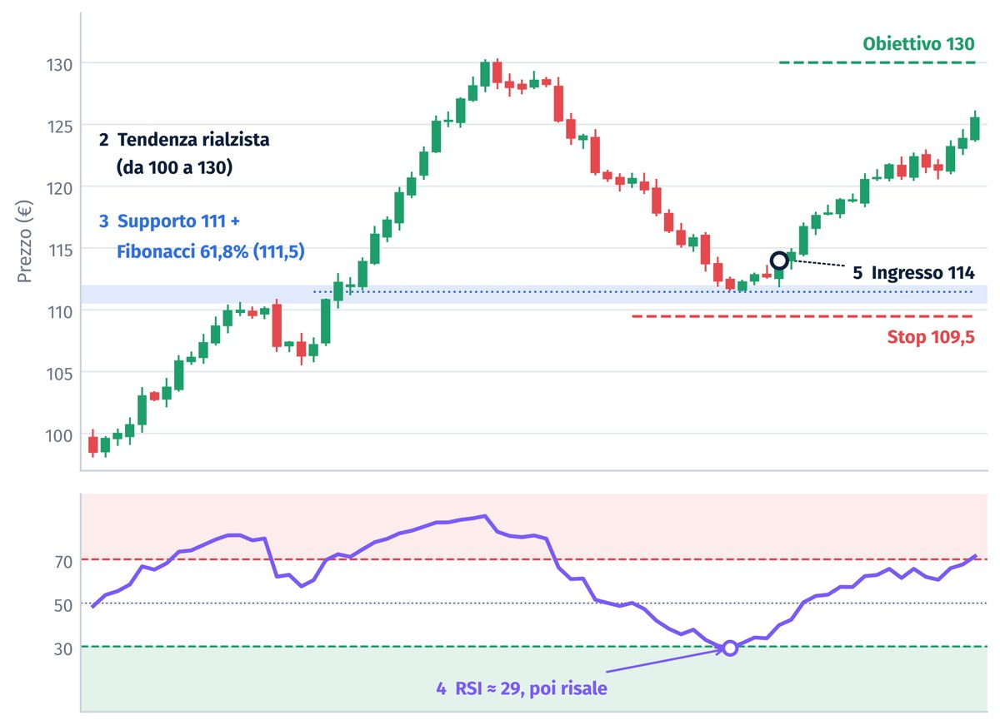

## Un manuale nato da appunti di studio

Qualche tempo fa ho iniziato a studiare l'analisi tecnica dei mercati finanziari da autodidatta, partendo da quello che si trova online. Come spesso accade, le informazioni erano ovunque ma poco ordinate: ogni fonte spiegava un pezzo, con un linguaggio diverso, e spesso dava per scontato quello che un principiante non sa ancora.

Ho quindi messo in ordine i miei appunti e li ho trasformati in una **mini guida ai concetti di base**, breve e leggibile. Oggi la pubblico qui, **gratuitamente**, in formato PDF ed EPUB.

<!--more-->

## A chi è rivolto

Il manuale è pensato per chi **parte da zero** o conosce solo qualche nozione. Non è un testo per trader esperti e non vuole esserlo: l'obiettivo è che sia facile da leggere, ma non così elementare da risultare inutile.

Se hai già anni di esperienza con i grafici, probabilmente non troverai nulla di nuovo. Se invece ti stai avvicinando ora all'argomento, può essere un punto di partenza ordinato.

## Cosa trovi dentro

- **I grafici**: linea, barre, candele giapponesi e candele Heikin-Ashi, con le differenze tra loro.
- **Supporti, resistenze e linee di tendenza**: i livelli che molti operatori osservano e come riconoscerli.
- **Undici indicatori tecnici**: media mobile, ADX e DMI, MACD, RSI, bande di Bollinger, volumi e OBV, pivot point, ritracciamenti di Fibonacci, onde di Elliott, Alligator e TSF.
- **Una struttura uniforme per ogni indicatore**: cos'è, come leggerlo, come usarlo nel trading e consigli strategici.
- **Valutazione e gestione del rischio**: come capire se un indicatore funziona davvero e come decidere in anticipo quanto rischiare.
- **Un caso pratico in cinque passi**, con numeri di esempio, dal grafico fino alla decisione.
- **Test di verifica con soluzioni** e un glossario dei termini.

Il libro conta 38 pagine ed è pensato per essere letto in una o due sere.

## Come sono fatte le pagine

Ho voluto che ogni concetto avesse un grafico a colori, per capirlo a colpo d'occhio. Tutti i grafici sono **illustrazioni originali, realizzate su dati simulati**: servono a mostrare come funziona uno strumento, non a documentare l'andamento di un mercato reale.

*Le candele giapponesi: a sinistra l'anatomia di una candela, a destra una serie di prezzi simulati.*

*L'RSI con le zone di ipercomprato (sopra 70) e ipervenduto (sotto 30).*

L'ultima parte del libro mette insieme gli strumenti in un esempio completo: un'azione ipotetica, un supporto che coincide con un livello di Fibonacci, un segnale dell'RSI e il calcolo del rischio con ingresso, stop e obiettivo.

*Il caso di esempio: i numeri sono inventati e servono solo per fare pratica.*

## Cosa non è questo manuale

Vale la pena essere onesti sui limiti:

- **Non è consulenza finanziaria** né un invito a investire. È materiale informativo e didattico.
- **Non promette risultati.** L'analisi tecnica non permette di prevedere il futuro con certezza: serve a ragionare per scenari e probabilità, e il libro dedica spazio anche alle critiche, come la teoria del cammino casuale (*random walk*).
- **Nessun indicatore funziona sempre.** Per questo la parte sulla gestione del rischio conta più di qualsiasi strategia.

Se vuoi provare a mettere in pratica quello che leggi, il consiglio è di usare un conto demo, con denaro virtuale, prima di rischiare denaro vero.

## Come l'ho realizzato

Il testo di partenza era una mia bozza. Per completarla, riscriverla in modo uniforme e preparare i file ho lavorato con **Claude**, l'assistente di Anthropic, che mi ha aiutato a completare i capitoli mancanti, a uniformare lo stile e a produrre i grafici. Il formato finale è nato in **LaTeX** per il PDF, con una versione EPUB per la lettura su telefono e lettori di ebook.

Racconto questo passaggio perché è coerente con quello di cui parlo di solito su questo blog: l'AI come strumento che accelera il lavoro, ma che richiede di rileggere, correggere e decidere. Se trovi errori o passaggi poco chiari, **scrivimi**: è un manuale che intendo migliorare.

## Scarica il manuale

- 📕 [Scarica il PDF](/libri/analisi-tecnica/Analisi_tecnica_dei_mercati_finanziari.pdf) (circa 1,9 MB, ottimo per il computer)
- 📱 [Scarica l'EPUB](/libri/analisi-tecnica/Analisi_tecnica_dei_mercati_finanziari.epub) (circa 1,3 MB, per telefono e lettori di ebook)

### Licenza

Il manuale è distribuito con licenza [Creative Commons Attribuzione – Non commerciale – Non opere derivate 4.0 Internazionale (CC BY-NC-ND 4.0)](https://creativecommons.org/licenses/by-nc-nd/4.0/deed.it). Puoi condividerlo liberamente, citando l'autore, senza usi commerciali e senza modificarlo.

Hai domande, correzioni o suggerimenti? Trovi i miei contatti nella pagina [Contatti](/contact/).

---

*Disclaimer: i contenuti di questo manuale e di questo articolo hanno scopo esclusivamente informativo e didattico e non costituiscono consulenza finanziaria, raccomandazione di investimento o sollecitazione all'acquisto o alla vendita di strumenti finanziari. Investire comporta il rischio di perdere parte o tutto il capitale.*
